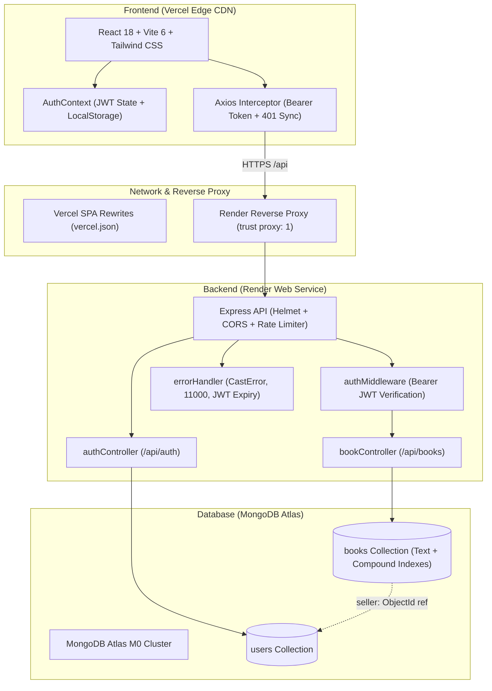

# The BookMarket — Peer-to-Peer Second-Hand Book Marketplace

[](https://bookmarket-client.vercel.app)
[](https://the-bookmarket-api.onrender.com/health)
[](https://cloud.mongodb.com)
[](https://github.com/AbhimanyuGit2507/bookmarket)
[](LICENSE)

> A production-grade, peer-to-peer second-hand book marketplace SaaS built on the modern MERN stack. Designed with defensive backend engineering, relational Mongoose schemas with compound and full-text search indexes, native JWT authentication with bcrypt password hashing, and a responsive React frontend.

---

## 🚀 Live Deployments

| Component | Platform | Live URL | Health Status |
| :--- | :--- | :--- | :--- |
| **Frontend Web App** | **Vercel** | [https://bookmarket-client.vercel.app](https://bookmarket-client.vercel.app) | 🟢 Live (HTTP 200) |
| **Backend REST API** | **Render** | [https://the-bookmarket-api.onrender.com](https://the-bookmarket-api.onrender.com) | 🟢 Live (Node.js/Express) |
| **API Healthcheck** | **Render** | [https://the-bookmarket-api.onrender.com/health](https://the-bookmarket-api.onrender.com/health) | 🟢 `{"status":"ok","database":"connected"}` |
| **Cloud Database** | **MongoDB Atlas** | `Cluster0.tqddi4l.mongodb.net` | 🟢 25 Seeded Listings across 5 Genres |
| **Source Code** | **GitHub** | [https://github.com/AbhimanyuGit2507/bookmarket](https://github.com/AbhimanyuGit2507/bookmarket) | 🟢 Main Branch (Up to Date) |

> ⏳ **Render Cold-Start Notice**: On Render’s free tier, backend instances spin down after inactivity. The very first request after idle may take **30–50 seconds** to wake up. Once warmed, all responses return in milliseconds.

---

## 🏗️ High-Level System Architecture



---

## 🔑 Evaluator & Demo Accounts

For immediate evaluation, the application includes pre-configured evaluator accounts with distinct inventories, incoming purchase inquiries, and sales statistics. On the [Login Page](https://bookmarket-client.vercel.app/login), use the **1-Click Fill** buttons or enter the credentials below:

| Account Name | Email | Password | Primary Role & Location | Pre-loaded Inventory |
| :--- | :--- | :--- | :--- | :--- |
| **Abhimanyu Negi** | `abhimanyu.25bcs10330@sst.scaler.com` | `password123` | **Primary Author** · Bengaluru, India | *MERN Fundamentals* by Mrinal sir |
| **Alex Turner** | `seller@bookmarket.com` | `password123` | **Demo Seller** · San Francisco, CA | 8 books (Algorithms, Dune, Atomic Habits, etc.) |
| **Maya Lin** | `buyer@bookmarket.com` | `password123` | **Demo Buyer & Seller** · Seattle, WA | 6 books (Pragmatic Programmer, Berserk, etc.) |
| **David Chen** | `david@bookmarket.com` | `password123` | **Peer Seller** · Austin, TX | 5 books (Clean Code, Sapiens, SAT Guide, etc.) |
| **Sarah Jenkins** | `sarah@bookmarket.com` | `password123` | **Peer Seller** · Boston, MA | 5 books (SICP, 1984, Deep Work, FE Exam, etc.) |

---

## ✨ Key Features & Architectural Highlights

### 1. Peer-to-Peer Communication (No Third-Party Gateway Fees)
Rather than trapping student funds behind third-party payment gateways with processing fees and escrow delays, The BookMarket enables direct peer transactions:
- **One-Click WhatsApp Redirection**: Automatically generates a pre-formatted `https://wa.me/<phone>?text=...` deep-link populated with the exact book title, listed price, and buyer greeting.
- **In-Platform Buy Inquiries**: Buyers can submit a direct purchase inquiry sharing their contact details and preferred campus meetup location.
- **Real-Time Seller Lead Inbox**: Sellers manage incoming buyer inquiries inside their private dashboard with 1-click status transitions (`Accept`, `Complete`, `Decline`).

### 2. Dual Role Architecture (Buyer + Seller in One Account)
Any user can seamlessly buy and sell without switching accounts:
- **Seller Inventory**: View active listings, mark items as `Reserved` or `Sold`, track estimated revenue, and review buyer inquiries.
- **Buyer Inquiries**: Track outgoing purchase requests with the seller's verified phone and email for easy follow-up.

### 3. Full-Text Search & Compound Indexing
- **Text Search Index**: `{ title: 'text', author: 'text', description: 'text' }` for lightning-fast keyword searches.
- **Compound Query Index**: `{ status: 1, genre: 1, price: 1 }` ensures high-throughput multi-filter queries (genre tab + condition + price slider) stay under 10ms.

### 4. Enterprise-Grade Security & Defensive Engineering
- **HTTP Security Headers**: Enforced via `helmet()`.
- **Sliding-Window Rate Limiting**: 150 requests per 15-minute window via `express-rate-limit`.
- **Payload Sanitization**: Express JSON body size restricted to `10kb` to prevent body-flood DoS attempts.
- **Reverse Proxy Resilience**: Configured `app.set('trust proxy', 1)` to accurately detect client IPs across Render/Cloudflare edge proxies.
- **Production CORS**: Intelligently parses comma-separated origins, strips trailing slashes, and accepts Vercel preview deployments (`*.vercel.app`).
- **Session Expiration Synchronization**: The Axios interceptor listens for 401 responses, automatically dispatches custom auth events, purges stale localStorage tokens, and updates React state in real time.

---

## 📦 Project Structure

The repository is organized as a clean, modular monorepo:

```text
bookmarket/
├── client/                             # Frontend Web Application (Vite 6 + React 18)
│   ├── public/                         # Static assets (favicons, manifest)
│   ├── src/
│   │   ├── api/
│   │   │   └── axios.js                # Centralized Axios instance with Bearer interceptors
│   │   ├── components/                 # Modular, reusable UI components
│   │   │   ├── BookCard.jsx            # Book card with spine effect, badges & onError fallback
│   │   │   ├── BookSkeleton.jsx        # Skeleton loaders for instant perceived performance
│   │   │   ├── BuyInquiryModal.jsx     # Direct peer purchase request modal
│   │   │   ├── CreateListingModal.jsx  # "Sell a Book" creation modal with presets
│   │   │   ├── DeleteConfirmModal.jsx  # Double-confirmation modal for safe deletion
│   │   │   ├── FilterSidebar.jsx       # Multi-criteria filtering (genre, condition, price)
│   │   │   ├── Footer.jsx              # Footer with platform links and disclaimer
│   │   │   └── Navbar.jsx              # Sticky header with search, auth state, and CTA
│   │   ├── context/
│   │   │   └── AuthContext.jsx         # Global user state, JWT persistence & event sync
│   │   ├── pages/
│   │   │   ├── BookDetailsPage.jsx     # Detailed book view, specs table, WhatsApp CTA
│   │   │   ├── DashboardPage.jsx       # Dual-tab dashboard (Seller inventory + Buyer requests)
│   │   │   ├── HomePage.jsx            # Main catalog, hero banner, pills, pagination
│   │   │   ├── LoginPage.jsx           # Sign-in page with 1-click evaluator filler
│   │   │   ├── NotFoundPage.jsx        # Defensive 404 handler
│   │   │   └── RegisterPage.jsx        # Sign-up page with phone, city, and validation
│   │   ├── App.jsx                     # Root React routing configuration
│   │   ├── index.css                   # Global styles & Tailwind utilities
│   │   └── main.jsx                    # Application entry point
│   ├── index.html                      # HTML template with Google Fonts (Playfair + Jakarta)
│   ├── package.json                    # Frontend dependencies
│   ├── tailwind.config.js              # Custom warm editorial color palette & typography
│   ├── vercel.json                     # Single Page Application rewrite rules for Vercel
│   └── vite.config.js                  # Vite bundler configuration
│
├── server/                             # Backend REST API (Node.js + Express + Mongoose)
│   ├── config/
│   │   └── db.js                       # Resilient MongoDB connection with retry backoff
│   ├── controllers/
│   │   ├── authController.js           # Register, login, and current profile endpoints
│   │   └── bookController.js           # Catalog search, CRUD, status mutation, inquiries
│   ├── middleware/
│   │   ├── auth.js                     # Bearer JWT verification & user attachment
│   │   └── errorHandler.js             # Centralized error handler (CastError, 11000, JWT)
│   ├── models/
│   │   ├── Book.js                     # Book schema with full-text search & compound index
│   │   └── User.js                     # User schema with email uniqueness & password hiding
│   ├── routes/
│   │   ├── authRoutes.js               # /api/auth routes
│   │   └── bookRoutes.js               # /api/books routes (sub-routes declared before /:id)
│   ├── seeds/
│   │   └── seed.js                     # Safe seed script preserving real registered users
│   ├── tests/
│   │   └── integration.test.js         # 29-step automated test suite
│   ├── index.js                        # Express server entry point (0.0.0.0 listener)
│   └── package.json                    # Backend dependencies
│
├── .gitignore                          # Ignores node_modules, .env, *.pid, *.log
├── package.json                        # Monorepo root scripts & deployment helpers
├── render.yaml                         # Render Blueprint specification
├── start-local.sh                      # 1-command startup script with process detachment
├── status-local.sh                     # 1-command health & port inspector
├── stop-local.sh                       # 1-command shutdown script
└── README.md                           # Comprehensive documentation
```

---

## 🛠️ REST API Reference

### Authentication Endpoints (`/api/auth`)

| Method | Endpoint | Auth | Request Body | Description |
| :--- | :--- | :--- | :--- | :--- |
| `POST` | `/api/auth/register` | Public | `{ name, email, password, phoneOrWhatsApp, city }` | Hashes password (bcrypt, 10 rounds), creates User, returns signed JWT |
| `POST` | `/api/auth/login` | Public | `{ email, password }` | Validates credentials with `bcrypt.compare`, returns signed JWT |
| `GET` | `/api/auth/me` | Protected | None (Bearer Token) | Returns current authenticated user profile |

### Book Marketplace Endpoints (`/api/books`)

| Method | Endpoint | Auth | Query / Body Parameters | Description |
| :--- | :--- | :--- | :--- | :--- |
| `GET` | `/api/books` | Public | `search`, `genre`, `condition`, `minPrice`, `maxPrice`, `sort`, `page`, `limit` | Paginated catalog search with text & compound filtering |
| `GET` | `/api/books/:id` | Public | URL parameter `:id` | Fetches book details with populated seller contact info |
| `POST` | `/api/books` | Protected | `{ title, author, isbn, genre, condition, price, originalPrice, description, coverImage, city }` | Creates new book listing attached to authenticated user (`seller: req.user._id`) |
| `GET` | `/api/books/my/listings` | Protected | None (Bearer Token) | Fetches current user's listings, incoming buyer leads & revenue stats |
| `GET` | `/api/books/my/inquiries` | Protected | None (Bearer Token) | Fetches current user's outgoing purchase requests with seller contact details |
| `POST` | `/api/books/:id/inquire` | Protected | `{ message, preferredMeetup }` | Submits purchase request (stores buyer contact, prevents self-inquiries) |
| `PATCH` | `/api/books/:id/status` | Protected | `{ status: 'available' \| 'reserved' \| 'sold' }` | Updates listing status. Restricted to listing owner (403 for non-owners) |
| `PATCH` | `/api/books/:bookId/inquiries/:inquiryId` | Protected | `{ status: 'accepted' \| 'completed' \| 'declined' }` | Seller accepts or completes inquiry; accepting auto-reserves the book |
| `DELETE` | `/api/books/:id` | Protected | URL parameter `:id` | Deletes listing. Restricted to listing owner (403 for non-owners) |

### System Health Endpoint

| Method | Endpoint | Auth | Description |
| :--- | :--- | :--- | :--- |
| `GET` | `/health` | Public | Service liveness probe `{ status: 'ok', database: 'connected', uptime, timestamp }` |

---

## 🗄️ Database Schemas & Data Model

### User Schema (`models/User.js`)
```javascript
{
  name: { type: String, required: true, trim: true },
  email: { type: String, required: true, unique: true, lowercase: true, trim: true },
  password: { type: String, required: true, minlength: 6, select: false },
  phoneOrWhatsApp: { type: String, required: true, trim: true },
  city: { type: String, required: true, trim: true },
  avatar: { type: String, default: '' },
  createdAt: { type: Date, default: Date.now }
}
```

### Book Schema (`models/Book.js`)
```javascript
{
  title: { type: String, required: true, trim: true, maxlength: 180 },
  author: { type: String, required: true, trim: true, maxlength: 100 },
  isbn: { type: String, trim: true, default: '' },
  genre: { 
    type: String, 
    required: true, 
    enum: ['Engineering & CS', 'Fiction & Sci-Fi', 'Non-Fiction', 'Comics & Manga', 'Exam Prep'] 
  },
  condition: { 
    type: String, 
    required: true, 
    enum: ['Brand New', 'Like New', 'Gently Used', 'Heavily Read'] 
  },
  price: { type: Number, required: true, min: 0 },
  originalPrice: { type: Number, default: 0 },
  description: { type: String, required: true, maxlength: 2000 },
  coverImage: { type: String, default: 'https://images.unsplash.com/photo-1544716278-ca5e3f4abd8c?auto=format&fit=crop&w=800&q=80' },
  status: { type: String, enum: ['available', 'reserved', 'sold'], default: 'available' },
  city: { type: String, required: true, trim: true },
  seller: { type: mongoose.Schema.Types.ObjectId, ref: 'User', required: true },
  inquiries: [
    {
      buyer: { type: mongoose.Schema.Types.ObjectId, ref: 'User', required: true },
      buyerName: { type: String, required: true },
      buyerEmail: { type: String, required: true },
      buyerPhone: { type: String, required: true },
      buyerCity: { type: String, default: '' },
      message: { type: String, default: '' },
      preferredMeetup: { type: String, default: '' },
      status: { type: String, enum: ['pending', 'accepted', 'completed', 'declined'], default: 'pending' },
      createdAt: { type: Date, default: Date.now }
    }
  ],
  createdAt: { type: Date, default: Date.now }
}

// Database Indexes:
// 1. Text Search Index:
bookSchema.index({ title: 'text', author: 'text', description: 'text' });
// 2. Compound Filter Index:
bookSchema.index({ status: 1, genre: 1, price: 1 });
```

---

## 💻 Local Development Setup

### 1. Prerequisites
- **Node.js** (v18.x or v20.x or v24.x)
- **MongoDB** running locally on `127.0.0.1:27017` or a cloud MongoDB Atlas connection URI

### 2. Clone & Install Dependencies
```bash
git clone https://github.com/AbhimanyuGit2507/bookmarket.git
cd bookmarket

# Install root, backend, and frontend packages in one command:
npm run install:all
```

### 3. Environment Variables

Create `.env` in `server/`:
```env
PORT=5000
MONGO_URI=mongodb://127.0.0.1:27017/bookmarket
JWT_SECRET=super_secret_jwt_key_bookmarket_dev_2026
CLIENT_URL=http://localhost:5173
NODE_ENV=development
```

Create `.env` in `client/`:
```env
VITE_API_BASE_URL=http://localhost:5000/api
```

### 4. Populate Local Database
```bash
npm run seed
```

### 5. Running the Application (1-Command Scripts)
We provide production-grade bash scripts that handle port cleanups, background process detachment (`set -m`, `disown`), and health polling:

```bash
# 🚀 Start MongoDB, Backend API (5000), and Frontend (5173):
./start-local.sh
# (or via npm: npm run start:local)

# 📋 Inspect service health & uptimes:
./status-local.sh
# (or via npm: npm run status:local)

# 🛑 Cleanly terminate both services:
./stop-local.sh
# (or via npm: npm run stop:local)
```

*(Alternatively, run backend and frontend separately in two terminal tabs: `npm run server` and `npm run client`.)*

---

## 🧪 Automated Integration Test Suite

The codebase includes an end-to-end integration test suite verifying health endpoints, authentication flows, catalog queries, CRUD authorization, and peer purchase inquiries:

```bash
npm test
```

### Test Coverage Breakdown (29/29 Passing)

```text
========================================
  THE BOOKMARKET: COMPREHENSIVE TEST SUITE
========================================

1. Health & Server Infrastructure
  ✓ GET /health returns 200 with status "ok"

2. Authentication & Security
  ✓ POST /api/auth/register fails if required fields are missing
  ✓ POST /api/auth/register fails if password is too short (<6 chars)
  ✓ POST /api/auth/register successfully creates user & returns JWT
  ✓ POST /api/auth/register prevents duplicate email registration
  ✓ POST /api/auth/login succeeds with valid credentials
  ✓ POST /api/auth/login fails with wrong password
  ✓ POST /api/auth/login fails with unregistered email
  ✓ GET /api/auth/me succeeds with valid Bearer token
  ✓ GET /api/auth/me rejects request without token (401)
  ✓ GET /api/auth/me rejects request with forged token (401)

3. Book Catalog & Filtering
  ✓ GET /api/books returns paginated listings
  ✓ GET /api/books filters accurately by genre
  ✓ GET /api/books filters accurately by condition
  ✓ GET /api/books filters accurately by price range
  ✓ GET /api/books search query matches title or author

4. Listing CRUD & Seller Ownership Control
  ✓ POST /api/books creates new listing for authenticated user
  ✓ GET /api/books/:id fetches book with populated seller info
  ✓ PATCH /api/books/:id/status allows owner to update status to "reserved"
  ✓ PATCH /api/books/:id/status rejects unauthorized user (403)
  ✓ GET /api/books/my/listings returns owner listings & calculated stats
  ✓ DELETE /api/books/:id rejects unauthorized deletion attempt (403)
  ✓ DELETE /api/books/:id allows owner to remove listing
  ✓ GET /api/books/:id returns 404 after deletion

5. Direct Peer Buy Inquiries & Dual Buyer/Seller Roles
  ✓ POST /api/books/:id/inquire allows a buyer to submit a direct purchase inquiry
  ✓ POST /api/books/:id/inquire prevents a seller from inquiring on their own listing (400)
  ✓ GET /api/books/my/inquiries returns buyer direct purchase inquiries with seller contact
  ✓ GET /api/books/my/listings returns incoming buyer inquiry on seller dashboard
  ✓ PATCH /api/books/:bookId/inquiries/:inquiryId allows seller to accept inquiry & auto-reserve book

========================================
  TEST RESULTS: 29 PASSED | 0 FAILED
========================================
```

---

## ☁️ Production Deployment Guide

### Backend on Render (Web Service)
1. In Render, click **New +** → **Web Service**.
2. Select your repository: `https://github.com/AbhimanyuGit2507/bookmarket`.
3. Configure settings:
   - **Root Directory**: `server`
   - **Environment**: `Node`
   - **Build Command**: `npm install`
   - **Start Command**: `node index.js`
   - **Health Check Path**: `/health`
4. Add Environment Variables:
   - `NODE_ENV`: `production`
   - `CLIENT_URL`: `https://bookmarket-client.vercel.app,http://localhost:5173`
   - `JWT_SECRET`: *(secure random 32+ character string)*
   - `MONGO_URI`: `mongodb+srv://<user>:<password>@cluster0.xxx.mongodb.net/bookmarket?retryWrites=true&w=majority`
5. Click **Create Web Service**.

### Frontend on Vercel
1. In Vercel, click **Add New...** → **Project** and select `bookmarket`.
2. Configure settings:
   - **Framework Preset**: `Vite`
   - **Root Directory**: `client`
   - **Build Command**: `vite build`
   - **Output Directory**: `dist`
3. Add Environment Variable:
   - `VITE_API_BASE_URL`: `https://the-bookmarket-api.onrender.com/api`
4. Click **Deploy**. Vercel will build and serve your app globally on its Edge network.

---

## 👤 Author & Academic Evaluation

- **Author**: Abhimanyu Negi
- **Email**: [abhimanyu.25bcs10330@sst.scaler.com](mailto:abhimanyu.25bcs10330@sst.scaler.com) / [avi2507.work@gmail.com](mailto:avi2507.work@gmail.com)
- **GitHub**: [@AbhimanyuGit2507](https://github.com/AbhimanyuGit2507)
- **Repository**: [https://github.com/AbhimanyuGit2507/bookmarket](https://github.com/AbhimanyuGit2507/bookmarket)
- **Course / Track**: Full-Stack MERN Architecture Capstone

---

## 📄 License
This project is licensed under the MIT License — feel free to use and adapt it for educational and commercial purposes.
